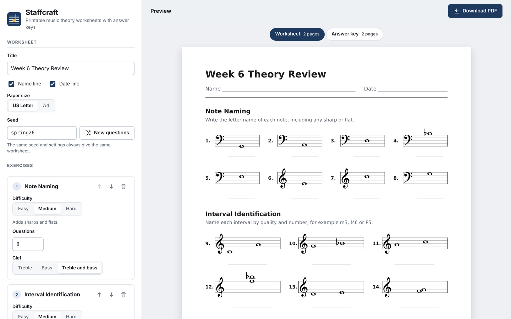

# Staffcraft

**Printable music theory worksheets with answer keys, generated in your browser.**

Staffcraft lets music teachers build a worksheet in a few clicks: choose the exercise types,
the number of questions and the difficulty, preview it live, and download a print-ready PDF
with the answer key on its own page. Every worksheet comes from a seed, so the same seed and
settings always give exactly the same questions.



[View a sample PDF](docs/sample-worksheet.pdf) (worksheet and answer key, US Letter)

## Features

- **Four exercise types**, each with easy, medium and hard levels:
  - **Note naming**: treble and/or bass clef, with sharps, flats and up to three ledger lines
  - **Interval identification**: major and perfect, then minor, then augmented, diminished and
    compound intervals, written harmonically, melodically or both
  - **Key signatures**: major keys, then major and relative minor, up to all fifteen keys
  - **Rhythm counting**: whole notes through sixteenths, dots and rests, in 4/4, 3/4, 2/4 and 6/8
- **Worksheet builder**: combine up to eight exercise sections, set a title, and toggle name and
  date lines
- **Live preview** of both the worksheet and the answer key, page by page
- **PDF export** on US Letter or A4, with the answer key starting on a new page
- **Reproducible**: one seed controls the whole worksheet, and each section has its own random
  stream, so editing one section never reshuffles another
- **Private and offline-friendly**: everything runs client-side. There is no backend and no
  account, and your last worksheet is remembered in the browser
- Accessible, responsive UI with light and dark themes

## Tech stack

| Area     | Choice                                                                                                            |
| -------- | ----------------------------------------------------------------------------------------------------------------- |
| App      | [React 19](https://react.dev), [TypeScript](https://www.typescriptlang.org) (strict), [Vite](https://vite.dev)    |
| Notation | [VexFlow 4](https://www.vexflow.com), behind Staffcraft's own `NotationRenderer` interface                        |
| PDF      | [jsPDF](https://github.com/parallax/jsPDF) + [svg2pdf.js](https://github.com/yWorks/svg2pdf.js), loaded on demand |
| Testing  | [Vitest](https://vitest.dev), [Testing Library](https://testing-library.com), jsdom                               |
| Quality  | ESLint (type-checked rules), Prettier, GitHub Actions CI                                                          |

## Getting started

You need [Node.js](https://nodejs.org) 22 or later.

```sh
git clone https://github.com/alexbrogan10/staffcraft.git
cd staffcraft
npm install
npm run dev
```

Then open the URL Vite prints (usually http://localhost:5173).

| Command              | What it does                                  |
| -------------------- | --------------------------------------------- |
| `npm run dev`        | Start the development server                  |
| `npm test`           | Run the unit and component tests once         |
| `npm run test:watch` | Run tests in watch mode                       |
| `npm run lint`       | Lint with ESLint                              |
| `npm run typecheck`  | Type-check the app, tests and config          |
| `npm run format`     | Format everything with Prettier               |
| `npm run build`      | Type-check and build for production (`dist/`) |
| `npm run preview`    | Serve the production build locally            |

No environment variables are required. [`.env.example`](.env.example) lists the optional ones,
such as the base path for hosting under a subfolder (for example on GitHub Pages).

## How it works

Staffcraft is split into layers. Each layer imports only from the layers above it, and ESLint
enforces the boundaries.

```
src/
├── domain/      Pure music theory: pitches, clefs, intervals, keys, durations, seeded random numbers
├── notation/    StaffSpec (plain data) and the NotationRenderer interface; VexFlow lives only in notation/vexflow
├── exercises/   One folder per exercise type, all implementing ExercisePlugin
├── worksheet/   Config → generated questions → paged layout → SVG pages
├── export/      SVG pages → PDF
└── ui/          React components and state
```

- **`domain`** has no React, DOM or library dependencies and is covered by unit tests.
- **Exercises** return plain data: questions, and a `QuestionBlock` describing the staff and the
  answer area. Every plugin must pass a shared contract test suite, which checks that generation
  is deterministic, questions are JSON-serializable, and each answer key lines up exactly with
  its worksheet.
- **One layout, two outputs**: the worksheet layer turns everything into SVG pages measured in
  PDF points. The live preview displays those pages, and the exporter hands the very same SVG to
  svg2pdf, so what you see is what prints.
- **Fonts**: jsPDF's built-in fonts cannot draw ♯ or ♭, so a small subset of DejaVu Sans is used
  for worksheet text, both in the preview and embedded in the PDF. Text is measured with a
  generated width table, so layout needs no DOM.

### Adding an exercise type

1. Create `src/exercises/<your-exercise>/index.ts` that exports an `ExercisePlugin`. It defines
   `generate` (seeded and pure), `render` (the student version) and `renderAnswer` (the answer
   key), plus a title, a description of each difficulty level, and any settings.
2. Add it to `EXERCISES` in [`src/exercises/registry.ts`](src/exercises/registry.ts).
3. Run `npm test`. The contract suite checks the new plugin automatically. Add tests for
   anything specific to it.

The builder UI, preview and PDF export pick it up with no further changes.

## Roadmap

- [ ] More exercise types: scale spelling, chord and triad identification, note writing
      (draw the note), and rhythm writing
- [ ] Alto and tenor clefs
- [ ] Shareable links that encode the worksheet settings
- [ ] Per-exercise options such as the interval list or which keys to include
- [ ] Several worksheet versions from one config (shuffled for each student)
- [ ] Teacher branding: school name and a logo in the header
- [ ] Hosted version on GitHub Pages
- [ ] Saved worksheet library and accounts (would need a backend)

## License

Staffcraft is free software licensed under the
[GNU Affero General Public License v3.0](LICENSE).

The worksheet font is a subset of [DejaVu Sans](https://dejavu-fonts.github.io/), distributed
under its own license; see [`public/fonts/LICENSE-DejaVu.txt`](public/fonts/LICENSE-DejaVu.txt).
